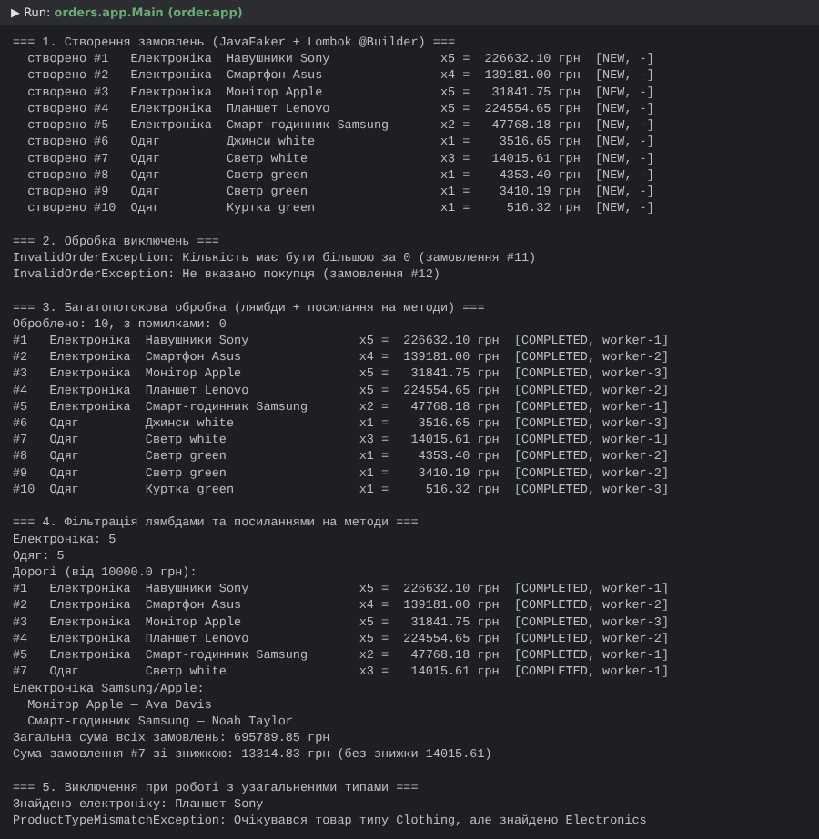
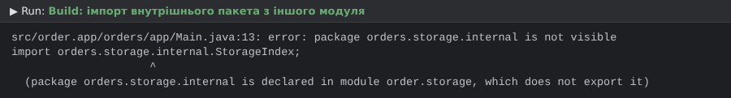

# Практична робота 4. Багатопотокова система управління замовленнями

Система обробки замовлень інтернет-магазину з використанням **узагальнень (Generics)**, **лямбда-виразів**,
**посилань на методи**, **модулів Java (JPMS)** та **багатопоточності**. Об'єкти товарів створюються через
**Lombok `@Builder`** і наповнюються випадковими даними з **JavaFaker**.

## Модулі (Maven multi-module + `module-info.java`)
| Maven-модуль | Java-модуль | Експортує | Закрито (internal) | Залежить від |
|---|---|---|---|---|
| `order-model` | `order.model` | `orders.model` | — | `lombok` (static) |
| `order-storage` | `order.storage` | `orders.storage` | `orders.storage.internal` | `order.model` (transitive) |
| `order-processing` | `order.processing` | `orders.processing` | `orders.processing.internal` | `order.storage` (transitive) |
| `order-concurrency` | `order.concurrency` | `orders.concurrency` | — | `order.processing` (transitive) |
| `order-app` | `order.app` | — | — | `order.concurrency`, `javafaker` |

**Контроль доступу:** пакети `*.internal` не експортуються, тому, наприклад, імпорт
`orders.storage.internal.StorageIndex` у модулі `order.app` дає помилку компіляції
`package orders.storage.internal is not visible` (див. `screenshots/module-access.png`).

## Як виконано вимоги
- **Узагальнення з обмеженням `extends`:** `Order<T extends Product>`, `OrderRepository<T extends Product>`,
  `OrderProcessor<T extends Product>`, `OrderDispatcher.dispatchAndWait(List<Order<T>>, Consumer<Order<T>>)` з `<T extends Product>`,
  wildcard `List<? extends Order<? extends Product>>` у `OrderProcessor.totalOf`. Типи `Electronics` і `Clothing` — підтипи `Product`.
- **Lombok `@Builder`:** `Electronics.builder()…build()`, `Clothing.builder()…build()` (+ `@Getter`, `@ToString`).
- **JavaFaker:** `ProductFactory` генерує ціни, бренди, кольори, матеріали, імена покупців, кількість.
- **Виключення при роботі з узагальненими типами:** `ProductTypeMismatchException` — `OrderRepository.findProduct(id, Class<R>)`
  перевіряє підтип товару замість небезпечного приведення (без `ClassCastException`);
  `InvalidOrderException` — перевірка замовлення (кількість ≤ 0, порожній покупець).
- **Лямбда-вирази:** завдання для пулу потоків `() -> handler.accept(order)`, фабрика потоків, фільтри `o -> …`.
- **Посилання на методи:** `electronicsProcessor::processOrder`, `factory::randomElectronics`, `OrderFilters::isExpensive`,
  `OrderFilters::describe`, `System.out::println`, `Order::getTotal`.
- **Багатопоточність:** `OrderDispatcher` — пул із 3 потоків (`worker-1..3`), `Future`, `AtomicInteger`-лічильники;
  сховище потокобезпечне (`ConcurrentHashMap`), статус замовлення `volatile`.

## Запуск
1. IntelliJ IDEA → File → Open → папка `Practice4-OrderSystem` (батьківський `pom.xml`), дочекатися імпорту Maven.
2. Запустити `orders.app.Main` у модулі `order-app`.
Або з консолі: `mvn install`, далі запуск `Main` з IDEA. Потрібні JDK 17+.

## Скріншоти

