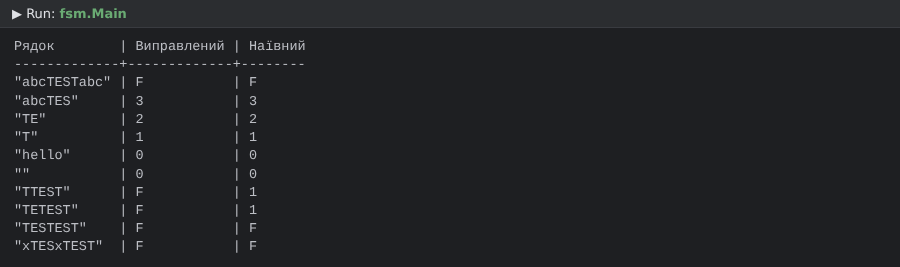
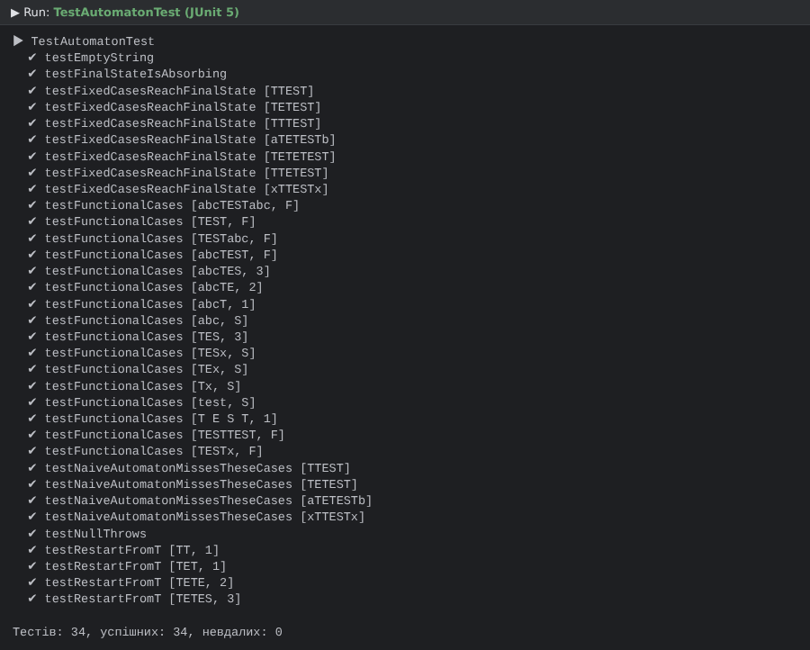

# Практична робота 5. Скінченний автомат для пошуку слова "TEST"

## Завдання
1. Автомат бере з рядка по одному символу і залежно від стану та символу змінює стан.
   Коли символи закінчуються — повертає кінцевий стан. `F` означає, що в рядку було слово `TEST`.
   Приклади: `"abcTESTabc" -> F`, `"abcTES" -> 3`.
2. Unit-тести з параметризацією (`@ParameterizedTest`, `@CsvSource`, `@ValueSource`).
3*. Знайти рядки зі словом `TEST`, на яких автомат не доходить до `F`, виправити реалізацію і покрити тестами.

## Таблиця переходів (виправлена)
Початковий стан — `S` (як на схемі з завдання), далі `1`, `2`, `3`, фінальний `F`.

| Стан | 'T' | 'E' | 'S' | інший |
|------|-----|-----|-----|-------|
| S    | 1   | S   | S   | S     |
| 1    | **1** | 2 | S   | S     |
| 2    | **1** | S | 3   | S     |
| 3    | F   | S   | S   | S     |
| F    | F   | F   | F   | F     |

## Завдання 3* — знайдена помилка
Наївна реалізація (`NaiveTestAutomaton`) при будь-якому неочікуваному символі повертається в стан `S`.
Але якщо цей символ — `T`, він може бути початком нового входження слова. Тому, наприклад:
- `"TTEST"`: T→1, **T→S** (помилка), E→S, S→S, T→1 — результат `1` замість `F`;
- `"TETEST"`: T→1, E→2, **T→S** (помилка), … — результат `1` замість `F`.

Виправлення в `TestAutomaton`: у станах `1` і `2` символ `T` переводить автомат у стан `1`.
(Для стану `3` символ `T` і так веде у `F`.) Це відповідає префікс-функції слова `TEST`.

## Структура
- `State` — перелік станів (`S, 1, 2, 3, F`).
- `TestAutomaton` — виправлений автомат (`next` — один перехід, `run` — обробка рядка).
- `NaiveTestAutomaton` — початкова версія з помилкою, для порівняння.
- `Main` — демонстрація роботи обох автоматів.
- `TestAutomatonTest` — параметризовані тести: функціональні кейси, порожній рядок, `null`,
  кейси з завдання 3* (і перевірка, що наївна версія на них помиляється).

## Запуск
IntelliJ IDEA: відкрити папку як Maven-проєкт → `fsm.Main`; тести — ПКМ по `src/test/java` → Run Tests.

## Скріншоти

